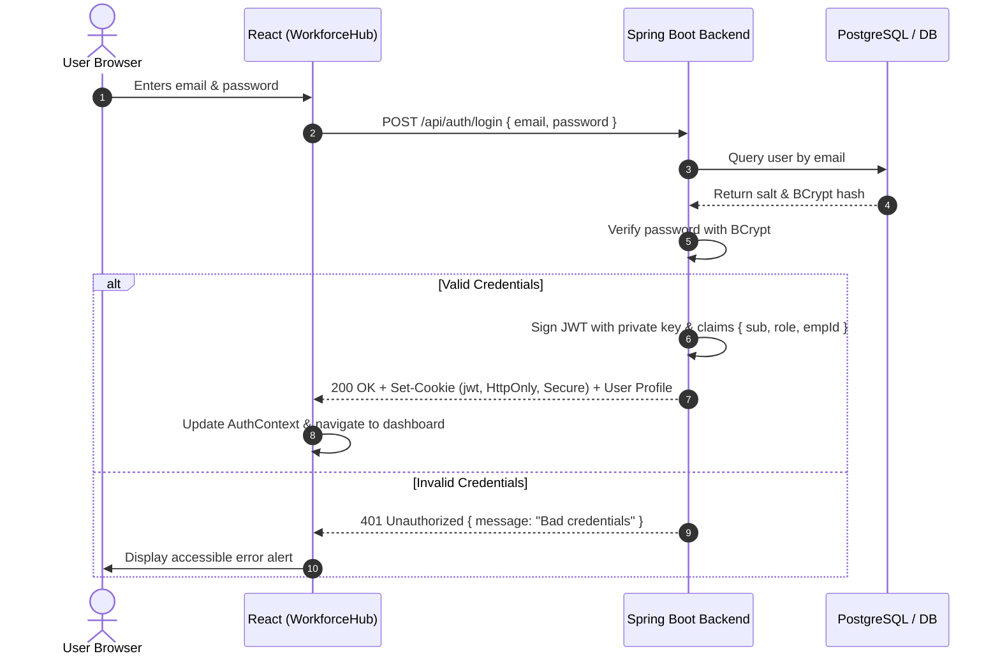

# WorkforceHub — Security Architecture & Phase 7 Authentication Assessment

## Executive Summary

Phase 7 establishes the **Authentication Foundation and Role-Based Access Control (RBAC)** prototype for **WorkforceHub**. This architecture introduces formal session lifecycles, route guards, role-aware user experiences, and a decoupled authentication service boundary.

> [!CAUTION]
> **Important Security Boundary Statement:**
> The authentication and authorization features in Phase 7 are **client-side demonstration abstractions**. They are engineered to validate interface workflows, navigation policies, and role segregation before backend integration.
> **They do not constitute production security boundaries.** Genuine security requires the Spring Boot backend and stateless JWT infrastructure scheduled for Phase 8.

---

## 1. Demonstration-Only Authentication Scope

The following components and behaviors operate in demonstration mode:

| Feature | Current Phase 7 Implementation | Production Target (Phase 8 Spring Boot) |
| :--- | :--- | :--- |
| **Identity Verification** | Checked in-memory against predefined mock identities (`admin@workforcehub.io`, `employee@workforcehub.io`). | `POST /api/auth/login` validating BCrypt password hashes stored in relational database. |
| **Session Persistence** | Sanitized user profile payload stored in browser `localStorage` (`workforcehub_auth_session`). | Cryptographically signed, stateless JSON Web Token (JWT) issued in an `HttpOnly`, `Secure`, `SameSite=Strict` cookie or Authorization header. |
| **Session Lifetime** | Managed in local state; invalidates upon user logout or manual storage clearance. | Token expiration with short-lived access tokens (e.g. 15 minutes) and server-managed refresh tokens with rotation. |
| **Credential Storage** | Plaintext passwords are **never** persisted to storage, logs, or history. | Handled via Spring Security's `PasswordEncoder` (`BCryptPasswordEncoder`, cost factor 12+). |

---

## 2. Frontend Route Guards vs. Server-Side Security

In Phase 7, route guards are implemented via:
- `ProtectedRoute`: Verifies that a session object exists in `AuthContext`; redirects unauthenticated requests to `/login`.
- `RoleProtectedRoute`: Restricts routes like `/employees`, `/departments`, and `/settings` to users with the `ADMIN` role, redirecting unauthorized users to `AccessDeniedPage` (403).

### Why Frontend Route Guards are Not Security Boundaries
1. **Client-Side Execution:** JavaScript executing in the user's browser is fundamentally under user control. A client can view source bundles, manipulate DevTools, alter React state, or edit `localStorage`.
2. **Data Exposure Without Backend Enforcement:** In a frontend-only application, if sensitive data was bundled into the client build or cached locally, route guards would only hide the visual presentation, not prevent raw inspection.
3. **No Non-Repudiation:** Actions performed solely in client memory cannot produce tamper-evident audit trails.

**Conclusion:** Frontend route guards provide an essential **User Experience (UX) affordance**, preventing accidental navigation into inappropriate forms and keeping interfaces focused. **They are not a defense against malicious actors.**

---

## 3. Why localStorage Roles Cannot Provide Real Authorization

Storing roles in `localStorage` (`"role": "ADMIN"`) allows anyone with access to the browser's Developer Tools Console to execute:
```javascript
localStorage.setItem('workforcehub_auth_session', JSON.stringify({ user: { role: 'ADMIN' } }));
```
Because of this fundamental browser model:
- **Client-supplied roles must never be trusted.**
- All authorization decisions must be validated by the server upon every single request.
- The server extracts claims from a verified digital signature (HMAC-SHA256 or RSA-256) that the client cannot forge without the private key.

---

## 4. Planned Spring Boot & JWT Architecture (Phase 8 Contract)

In Phase 8, the frontend service boundary in `src/services/authService.js` will connect directly to Spring Boot REST endpoints:



### Planned API Contracts:
1. `POST /api/auth/login`
   - **Request:** `{ "email": "admin@workforcehub.io", "password": "..." }`
   - **Response:** `200 OK` with JSON `{ "id": "...", "name": "...", "role": "ADMIN", ... }` and `Set-Cookie: jwt=...; HttpOnly; Secure; SameSite=Strict`
2. `POST /api/auth/logout`
   - **Response:** `200 OK` with `Set-Cookie: jwt=; Max-Age=0`
3. `GET /api/auth/me`
   - **Response:** Current authenticated principal validated from request cookie.

---

## 5. Requirement for Server-Side Role & Ownership Checks

When Spring Boot is introduced:
1. **Method Security:** Use `@PreAuthorize("hasRole('ADMIN')")` on administrative endpoints:
   - Employee mutations (POST/PUT/DELETE `/api/employees/**`)
   - Department management (POST/PUT/DELETE `/api/departments/**`)
   - System configuration (`/api/settings/**`)
2. **Object-Level Ownership Validation:**
   - When an `EMPLOYEE` accesses `/api/attendance` or `/api/leaves`, the server must ensure `employee.id == authenticatedPrincipal.employeeId`.
   - Prevent Insecure Direct Object References (IDOR): an employee must not be able to view or edit another employee's leave balance simply by changing a query parameter.
3. **Leave Approval Enforcement:**
   - Only supervisors and administrators with `@PreAuthorize("hasRole('ADMIN') or hasRole('MANAGER')")` may execute `PUT /api/leaves/{id}/status`.

---

## 6. Token Handling & Credential Protection Guidelines

1. **HttpOnly Cookies over Web Storage:**
   - JWTs should be stored in `HttpOnly` cookies, which are inaccessible to client-side scripts, neutralizing Cross-Site Scripting (XSS) token theft.
2. **CSRF Protection:**
   - Pair `HttpOnly` cookies with `SameSite=Strict` and Spring Security CSRF double-submit cookies or custom headers for state-changing actions.
3. **Short Expiration & Refresh Rotation:**
   - Access tokens should expire in 10–15 minutes.
   - Refresh tokens should be one-time use with token family invalidation if reuse is detected.
4. **Transport Layer Security (TLS):**
   - All communications must occur over HTTPS (TLS 1.3) to prevent credential sniffing in transit.
