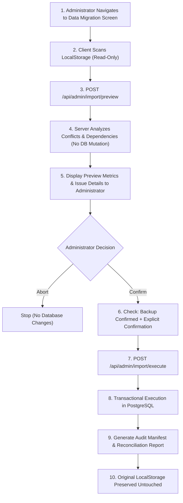

# WORKFORCEHUB — PHASE 8C.5 DATA IMPORT PLAN
## Safe Migration Architecture, Conflict Reconciliation & Recovery Strategy

**Date**: 2026-10-13  
**Status**: ACTIVE ARCHITECTURAL SPECIFICATION  
**Target Relational Database**: PostgreSQL 15+ (Spring Boot 3.4.3 / Spring Data JPA / Flyway)  
**Source Legacy Storage**: Browser LocalStorage (`workforcehub_*` keys)  

---

## 1. Executive Overview

Phase 8C.5 defines the safe, auditable, non-destructive data migration framework to transition historical human resource records previously stored in the browser's `localStorage` into PostgreSQL. 

Per the mandatory execution safety boundary, browser records have been strictly preserved throughout Phases 1–8C.4 and are never automatically imported on startup or login. This plan defines the multi-phase workflow ensuring that any persistence into PostgreSQL requires explicit administrator preview, dependency resolution, conflict reconciliation, and verified backup confirmation.

---

## 2. Discovered Source Storage Inventory & Data Shapes

The frontend legacy storage architecture contains four primary JSON datasets stored under well-defined keys:

### 1. Departments (`workforcehub_departments`)
- **Key**: `STORAGE_KEY_DEPARTMENTS = 'workforcehub_departments'`
- **Serialized Record Shape**:
  ```json
  {
    "id": "dept-1",
    "departmentId": "DEPT-001",
    "name": "Engineering",
    "description": "Core software engineering, cloud architecture, and data platforms.",
    "managerEmployeeId": "emp-1001",
    "status": "Active",
    "createdAt": "2023-01-15"
  }
  ```
- **Discovered Volume**: 6 standard organizational departments (`DEPT-001` through `DEPT-006`).

### 2. Employees (`workforcehub_employees`)
- **Key**: `STORAGE_KEY = 'workforcehub_employees'`
- **Serialized Record Shape**:
  ```json
  {
    "id": "emp-1001",
    "employeeId": "EMP-1001",
    "firstName": "Elena",
    "lastName": "Rostova",
    "email": "elena.rostova@workforcehub.com",
    "phone": "+1 (555) 234-5671",
    "department": "Engineering",
    "designation": "Senior Frontend Engineer",
    "joiningDate": "2023-03-15",
    "employmentStatus": "Active",
    "employmentType": "Full-Time",
    "address": "742 Evergreen Terrace, Seattle, WA"
  }
  ```
- **Discovered Volume**: 16 initial employee profiles (`EMP-1001` through `EMP-1016`).

### 3. Attendance Records (`workforcehub_attendance`)
- **Key**: `STORAGE_KEY_ATTENDANCE = 'workforcehub_attendance'`
- **Serialized Record Shape**:
  ```json
  {
    "id": "att-2026-10-13-1001",
    "employeeId": "emp-1001",
    "date": "2026-10-13",
    "checkIn": "08:45",
    "checkOut": "17:15",
    "status": "Present",
    "notes": "Completed full engineering sprint tasks."
  }
  ```
- **Discovered Volume**: Daily sample attendance records across team members.

### 4. Leave Requests (`workforcehub_leaves`)
- **Key**: `LEAVES_STORAGE_KEY = 'workforcehub_leaves'`
- **Serialized Record Shape**:
  ```json
  {
    "id": "leave-1001",
    "employeeId": "emp-1002",
    "leaveType": "Annual",
    "startDate": "2026-10-12",
    "endDate": "2026-10-16",
    "reason": "Annual family autumn retreat in Colorado.",
    "status": "Approved",
    "requestedDays": 5,
    "submittedAt": "2026-10-05T09:30:00.000Z",
    "reviewedAt": "2026-10-06T11:15:00.000Z",
    "reviewedBy": "Alex Morgan (HR Administrator)",
    "reviewerComment": "Approved. Product handoff confirmed."
  }
  ```
- **Discovered Volume**: 8 sample historical leave submissions (`leave-1001` through `leave-1008`).

---

## 3. Database Schema and Relationship Mapping

| Source Entity & Attribute | Target PostgreSQL Table & Column | Mapping & Conversion Rule |
|---|---|---|
| **Department** `id` | Memory lookup key | Transient source ID (`dept-1`) mapped to target UUID in `import_manifest`. |
| `departmentId` | `departments.department_code` | Direct string match (e.g., `DEPT-001`). Enforces uniqueness constraint `uq_departments_code`. |
| `name` | `departments.name` | Case-insensitive trimmed string match (`uq_departments_name`). |
| `status` | `departments.status` | Mapped to `Active` or `Inactive` (`chk_departments_status`). |
| `managerEmployeeId` | `departments.manager_employee_id` | Deferred lookup: resolved to database Employee UUID after employees are persisted. |
| **Employee** `id` | Memory lookup key | Transient source ID (`emp-1001`) mapped to target UUID in `import_manifest`. |
| `employeeId` | `employees.employee_code` | Direct code match (e.g., `EMP-1001`). Enforces `uq_employees_code`. |
| `email` | `employees.email` | Normalized lowercase string (`uq_employees_email`). |
| `department` | `employees.department_id` | Resolved via department code or name lookup to target `departments.id` (UUID). |
| `designation` | `employees.job_title` | Direct string copy. |
| `joiningDate` | `employees.joining_date` | Parsed ISO date (`YYYY-MM-DD`). Defaults to current date if missing. |
| `employmentStatus` | `employees.employment_status` | Enum `EmploymentStatus.fromString` (`ACTIVE`, `ON_LEAVE`, `INACTIVE`). |
| `employmentType` | `employees.employment_type` | Enum `EmploymentType.fromString` (`FULL_TIME`, `PART_TIME`, `CONTRACT`). |
| **Attendance** `id` | Memory lookup key | Source record identifier logged in `import_manifest`. |
| `employeeId` | `attendance_records.employee_id` | Foreign key resolved via source ID mapping or employee code. |
| `date` | `attendance_records.attendance_date` | SQL DATE (`YYYY-MM-DD`). Unique per employee (`uq_attendance_employee_date`). |
| `checkIn` / `checkOut` | `check_in_time` / `check_out_time` | SQL TIME parsed as `HH:mm`. Nullable for absence records per Flyway `V2`. |
| `status` | `attendance_records.status` | Enum `AttendanceStatus.fromString` (`PRESENT`, `LATE`, `HALF_DAY`, `ABSENT`). |
| **Leave** `id` | Memory lookup key | Source record identifier logged in `import_manifest`. |
| `employeeId` | `leave_requests.employee_id` | Foreign key resolved to target Employee UUID. |
| `leaveType` | `leave_requests.leave_type` | Enum `LeaveType.fromString` (`ANNUAL`, `SICK`, `PERSONAL`, `UNPAID`). |
| `startDate` / `endDate` | `start_date` / `end_date` | Validates `endDate >= startDate`. Duration calculated inclusive. |
| `status` | `leave_requests.status` | Enum `LeaveStatus` (`PENDING`, `APPROVED`, `REJECTED`). |
| `reviewerComment` | `leave_requests.review_comment` | Preserves historical review commentary without re-triggering side effects. |

---

## 4. Duplicate Detection & Conflict Resolution Policy

### Conflict Classifications

1. **Exact Duplicate / Existing Record (`EXISTING`)**:
   - Record in payload matches an existing PostgreSQL row by unique key:
     - Department: `department_code` or `name` exists.
     - Employee: `employee_code` or `email` exists.
     - Attendance: `(employee_id, attendance_date)` exists.
     - Leave: Employee already has identical or overlapping date span.
   - **Resolution Strategy**: Reuses existing PostgreSQL ID. Maps transient source ID to target UUID without creating a duplicate row.
2. **Conflicting Record (`CONFLICT`)**:
   - Record shares an identifier with a database row but has mismatched attributes (e.g., department code exists but name differs, or employee code matches but email differs).
   - **Resolution Strategy**: Flagged in preview as a conflict. Under `SKIP_EXISTING`, the database record is retained unmodified and the conflict is logged in the audit trail.
3. **Unresolved Reference (`UNRESOLVED_REF`)**:
   - Employee references a department that does not exist in PostgreSQL or the batch, or attendance/leave references an unresolvable employee.
   - **Resolution Strategy**: Flagged in preview. The dependent record is skipped during execution, and the failure is logged.
4. **Invalid Record (`INVALID`)**:
   - Missing required fields, invalid date formats, or contradictory chronology (`endDate < startDate`).
   - **Resolution Strategy**: Rejected at preview; excluded from execution.

---

## 5. Backup and Recovery Procedure

### Pre-Execution Backup Requirement
Before executing any persistent database import, an administrator must capture a verified PostgreSQL backup. The execution API strictly enforces this requirement by validating `confirmBackupTaken: true`.

#### PostgreSQL Backup Command
```bash
# Dump the current database schema and data
pg_dump -U postgres -h localhost -p 5432 -d workforcehub_db -F c -b -v -f "workforcehub_pre_import_backup_$(date +%Y%m%d_%H%M%S).dump"
```

#### Verification Command
```bash
# Verify dump integrity
pg_restore -l "workforcehub_pre_import_backup_*.dump" | head -n 25
```

### Rollback & Recovery Strategy
1. **Transactional Integrity**: All import operations within a job run inside a single database transaction (`@Transactional(rollbackFor = Exception.class)`). If an unhandled SQL exception or database crash occurs, PostgreSQL rolls back all partial inserts automatically.
2. **Audit Tracking (`import_jobs` & `import_manifest`)**: Every imported record is logged in `import_manifest` with its `job_id`, `entity_type`, `source_id`, `target_id`, and `action`.
3. **Targeted Recovery Command**:
   If an import needs to be rolled back without restoring the full database dump, all records created by a specific `jobId` can be queried or removed:
   ```sql
   -- View records created by a specific import job
   SELECT entity_type, target_id, action, details FROM import_manifest WHERE job_id = 'YOUR_JOB_UUID';
   ```

---

## 6. Import Preview and Confirmation Workflow



---

## 7. Security and Personal Data Protections

1. **ADMIN Role Restriction**: All import endpoints (`/api/admin/import/**`) require `ROLE_ADMIN` authentication and method security (`@PreAuthorize("hasRole('ADMIN')")`). Non-admin attempts return HTTP 403 Forbidden.
2. **CSRF Protection**: All POST requests enforce `X-XSRF-TOKEN` cookie verification.
3. **No Authentication Account Creation**: The import process never creates user accounts, passwords, or authentication credentials from HR records.
4. **Sanitized Audit Logging**: System logs and audit tables never record passwords, session cookies, tokens, or personal address details.

---

## 8. Summary of Implementation Artifacts

- **Flyway Migration**: `V3__import_jobs_audit.sql`
- **JPA Entities**: `ImportJob.java`, `ImportManifest.java`
- **JPA Repositories**: `ImportJobRepository.java`, `ImportManifestRepository.java`
- **Service Layer**: `ImportService.java`, `ImportServiceImpl.java`
- **Controller Layer**: `ImportController.java`
- **Frontend Service**: `importService.js`
- **Frontend UI**: `DataImportPage.jsx`, `import.css`
- **Navigation & Routes**: Added to `AppRoutes.jsx`, `Sidebar.jsx`
